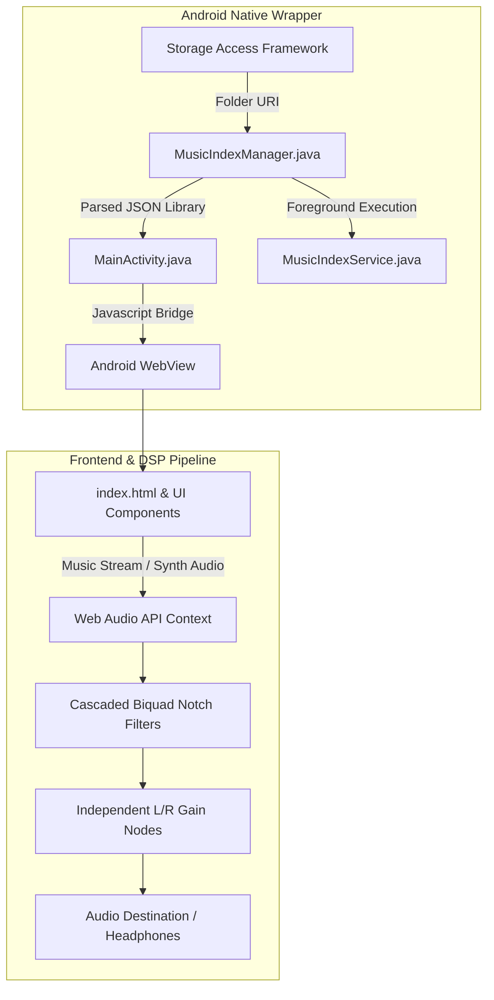

# Notched Sound

An advanced Android sound therapy and acoustic notch music player engineered for targeted tinnitus management. The application combines real-time Web Audio DSP filtering with a persistent Android foreground indexing service and a Poweramp-compatible music library player.

---

## Key Capabilities

### 1. Real-Time Notch Spectrum & Frequency Analysis
* **Docked Visualiser:** Sticky real-time canvas visualising the acoustic notch filter curve, active noise spectrum, and notch attenuation profile.
* **Dual-Ear Lateralisation:** Dedicated Left Ear and Right Ear volume controls docked immediately below the spectrum graph for individualised auditory balancing.
* **Acoustic Notch Filtering:** High-order cascaded biquad notch filters centered precisely on the user's identified tinnitus frequency (with configurable notch width / Q-factor).

### 2. Backdrop Soundscape Generator
* **Synthesised Soundscapes:** Calibrated background soundscapes including Brown Noise, Pink Noise, White Noise, Ocean Surf, Rainfall, Forest Stream, Woodland Birds, and Night Crickets.
* **Integrated Therapy Controls:** Direct start/stop sound therapy triggers embedded within the soundscape console.
* **0–12 Hour Continuous Session Timer:** Continuous duration slider ranging from 0 (`Continuous / ∞`) up to 12 hours (720 minutes, 15-minute resolution).
* **Gentle Fade-Out:** Custom exponential gain taper applied over the final therapy period to prevent abrupt acoustic rebound.

### 3. Poweramp-Compatible Music Player
* **Folder & Tag Indexing:** Storage Access Framework (SAF) tree integration allowing users to select their music collection directory on internal storage or microSD.
* **Tag Taxonomy:** Extracts ID3/Vorbis/MP4 tags (`MediaMetadataRetriever`) conforming to Poweramp music organisation standards.
* **Hierarchical Browsing:** Browse by Artist → Album → Track, with one-tap actions to play all tracks by an artist or a selected album.
* **Notched Music Playback:** User music tracks are routed directly through the real-time biquad notch filter chain, eliminating the tinnitus frequency band from personal music.
* **Vector Transport Controls:** Clean inline SVG controls for Shuffle, Repeat, Previous, Play/Pause, Next, and volume management.

### 4. Background Indexing Service (`MusicIndexService`)
* **Persistent Execution:** Runs as an Android Foreground Service (`FOREGROUND_SERVICE_DATA_SYNC`) with low-importance user notifications.
* **WakeLock Management:** Employs `PARTIAL_WAKE_LOCK` to ensure deep directory traversal and metadata extraction continue seamlessly when switching apps or locking the device.
* **Local Persistence:** Caches parsed library structures to `music_library.json` in private app storage for instantaneous startup without re-indexing.

---

## System Architecture



---

## Directory Layout

```
android-tinnitus-relief/
├── app/
│   ├── src/
│   │   └── main/
│   │       ├── AndroidManifest.xml
│   │       ├── assets/
│   │       │   └── index.html             # Web Audio DSP engine, spectrum, & player UI
│   │       ├── java/com/simon/tinnitusrelief/
│   │       │   ├── MainActivity.java      # WebView container & SAF callback
│   │       │   ├── MusicIndexManager.java # Background document crawler & ID3 extractor
│   │       │   └── MusicIndexService.java # Foreground persistence service
│   │       └── res/                       # Native layout, drawables, and app icons
│   └── build.gradle
├── gradle/
├── build.gradle
├── gradlew
├── gradlew.bat
├── settings.gradle
└── README.md
```

---

## Building from Source

### Prerequisites
* **Android SDK:** Platform 34 (Android 14)
* **Build Tools:** 34.0.0
* **JDK:** Java 17 (e.g. OpenJDK 17 or Android Studio JBR)
* **Gradle:** 8.x+ (bundled via Gradle Wrapper)

### Compilation
To compile the debug APK via PowerShell:

```powershell
$env:JAVA_HOME = "C:\Program Files\Android\Android Studio\jbr"
Set-Location "D:\android-tinnitus-relief"
.\gradlew.bat assembleDebug
```

The compiled binary is generated at:
```
app/build/outputs/apk/debug/app-debug.apk
```

---

## Licence & Attributions
Engineered for acoustic therapy and personal audio processing. Distributed under the MIT Licence.
